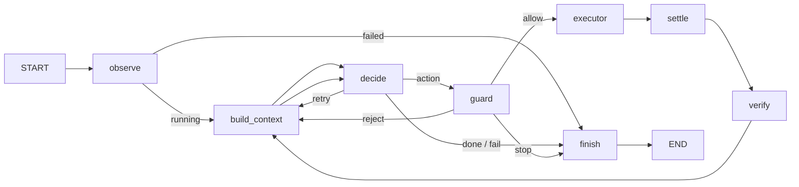

# Friday agent harness skeleton

## Purpose

This package defines the agent loop topology. `observe`, `build_context`,
`decide` (via injected, LLM-calling factories), `guard`, `executor`, `settle`,
`verify`, and `finish` are implemented; no default nodes remain stubs. The
harness itself imports no desktop client or network service at module load; I/O
is injected. Run a task with `python -m friday run "<goal>"` against a live
sandbox (see `src/friday/__main__.py`): the goal goes through observe →
build_context → decide → guard, and an allowed action is executed and
reconciled via executor → settle → verify before the loop continues.



## State

`AgentState` uses plain overwrite semantics with no reducers. Screenshots are paths, never image bytes, so future checkpointing serializes only state data.

The per-node read/write contract is generated from a single source
(`friday.harness.contract`, `scripts/gen_harness_contract.py`); the boundary
contract tests check every implemented node against it, so tests, code, and
docs cannot disagree:

```
<!-- GEN:node-contract -->
| Node | Reads | Writes |
| --- | --- | --- |
| observe | — | final_report, focused_app, screen_size, screenshot_path, status, windows |
| build_context | focused_app, goal, guard_verdict, hint, history, last_result, max_steps, pending_action, retries, screen_size, screenshot_path, step, windows | hint, prompt |
| decide | prompt, screenshot_path | decision, hint, pending_action, retries |
| guard | focused_app, history, max_steps, pending_action, retries, screen_size, started_at, status, step, stuck_count | guard_verdict, hint |
| executor | guard_verdict, pending_action | last_result |
| settle | focused_app, screenshot_path | focused_app, prev_screenshot_path, screen_size, screenshot_path, windows |
| verify | decision, hint, history, last_result, pending_action, prev_screenshot_path, screenshot_path, step, stuck_count | hint, history, step, stuck_count |
| finish | decision, final_report, guard_verdict, hint, status | final_report, status |
<!-- GEN:node-contract -->
```

`initial_state(goal, max_steps)` supplies neutral values. The default LangGraph recursion limit is in `harness.config`.

## Injected policy (`ControlPolicy`)

Approval and user-control status for a step are not state fields; they are carried by an injected `ControlPolicy` shared between the `build_context` and `guard` nodes. `build_context` surfaces them in the capability manifest (no input when the user controls the desktop, observing only without approval), and `guard` independently blocks input or requires approval on the same signal, so manual control gates execution even if the model was offered more than it may do. The default policy assumes no approval and no user control — conservative by design.

## Capability selection and risk tiers

`build_context` chooses capabilities independent of the goal text, based only on the authoritative registries, the configured allowlist (`harness.config`), the current `focused_app`, and the injected policy:

- Core observation and low-risk operations, and all input actions, are offered whenever the policy does not forbid them (under user control only observe capabilities are offered, no input).
- Shortcuts offered are exactly those `resolve_shortcut(name, focused_app)` accepts (`focused_app` `None` means `"other"`; an explicit-null binding never resolves), minus any `risky` shortcut when approval is not granted.
- Higher-risk operations (e.g. `delete_file`, `write_file`, `close_window`, `close_app`) are offered only when approval is granted. Under the default policy they are withheld but still named in the prompt's unavailable-note, so the model knows the class exists but needs approval that is unavailable. The whole action class is never hidden.
- Risk is a single shared source: `requires_approval(name)` in `capabilities.py` is used by both selection (to withhold) and the guard (to reject).

**Consistency invariant:** anything `build_context` offers under a policy must be something the guard could allow under the same policy (offering an operation the guard always rejects is a bug). The reverse is not required: the guard stays the enforcement point, and the model may still propose something not offered — the guard rejects it as before.

## Nodes

| Node | Reads | Writes | Next |
| --- | --- | --- | --- |
| observe | nothing | screenshot_path, screen_size, windows, focused_app; on fatal capture failure status, final_report | route_after_observe |
| decide | prompt, screenshot_path | decision, pending_action, retries, hint | route_after_decide |
| guard | pending_action, screen_size, budgets, history, stuck_count, focused_app, status | guard_verdict, hint | route_after_guard |
| executor | pending_action | last_result | settle |
| settle | screenshot_path, focused_app | prev_screenshot_path, screenshot_path, screen_size, windows, focused_app | verify |
| verify | screenshot paths, last_result, decision, pending_action, history, step, stuck_count | step, history, stuck_count, hint | build_context |
| build_context | goal, screen_size, windows, focused_app, history, last_result, hint, step, max_steps, retries, status, pending_action, guard_verdict | prompt, hint | decide |
| finish | status, final_report, decision, guard_verdict, hint | status, final_report | END |

`step`, `history`, and `stuck_count` are written by `verify`, the single owner,
on every pass through the loop. That is what lets the guard's step budget and
repeat check actually fire, so a live run terminates instead of recursing.
`verify` compares the pre/post screenshots (see `verify_diff`) to label the step
`failed` / `no_visible_change` / `changed` / `no_change_expected` / `unknown`,
increments `stuck_count` on a failure or screen-stall, resets it on a change,
and writes a fixed `hint` for a stalled step (never overwriting an existing
hint). A run that stops because the screen stopped changing is bounded by the
guard: once `stuck_count >= max_stuck`, the guard returns `stop` (at the cost of
one extra `decide` call before it does), and `finish` carries why into the final
report. `finish` resolves the terminal `status`/`final_report`; a failure set
earlier (observe capture, or a stuck run) is preserved. A
`route_after_verify` shortcut is deferred. Before settling, if the focused app
is a browser and a probe is injected, `settle` best-effort waits for the page to
finish loading so the screenshot that `verify` diffs is of a stable page; a
probe failure, absence or timeout never breaks the settle contract.

Expected execution failures belong in `last_result` with `ok: false`; they do not raise. Only routing reads `decision` or `guard_verdict`: `None` logs a warning and goes to finish, while an unknown value raises `ValueError`.

## Prompt flow

`build_context` renders the complete prompt — the static agent rules together with the dynamic facts — into `state["prompt"]`, and is the only node allowed to write that field. The static rules are a constant in `render.py`, never stored in mutable state themselves; they are folded into the returned `prompt` string, not injected into `decide` as a separate dependency. Other nodes write facts such as `hint` and `last_result`, never prompt text. `screen_size` is internal coordinate/bounds data and must never be rendered into a prompt. `build_context` folds a hint into the prompt and clears it afterward.

`observe` is the only implemented node: an injected desktop client collects the initial screenshot and safe system data, then an injected trace writer stores the screenshot and safe observation metadata. It does not build a prompt. Shortcut execution later resolves bindings against a fresh active-window lookup; a future guard may call the same resolver to reject unavailable shortcuts, and a future context builder may render only shortcuts available for `focused_app`.

## Routing tables

| From | Value | Destination |
| --- | --- | --- |
| observe | `status == failed` | finish |
| observe | any other status | build_context |
| decide | action | guard |
| decide | done, fail | finish |
| decide | retry | build_context |
| guard | allow | executor |
| guard | reject | build_context |
| guard | stop | finish |

## Replacing a stub

Implement one node file later, retaining the `AgentState -> dict` shape. Or inject one replacement without editing the graph:

```python
from dataclasses import replace

from friday.harness.graph import build_graph
from friday.harness.nodes import default_nodes

graph = build_graph(replace(default_nodes(), decide=my_decide))
```

## Composition root and fail-closed wiring

`friday.harness.compose.build_production_graph(deps)` is the single assembly
point for a live graph. It builds the real `observe`, `build_context`, `decide`,
`guard`, `executor`, `settle`, `verify`, and `finish` nodes from their factories
and `dataclasses.replace`s them onto `default_nodes()`. `settle` is built real
whenever `client`/`trace_writer` are present (the same gate as `observe`), and
`verify`/`finish` are always built real; `executor` is built real only when an
`ExecutorDeps` is supplied. Because `settle`/`verify` are real in exactly the
situations `observe` is, a live run can never act on stale state without
reconciling it: the executor is hardwired to a real `settle`+`verify`. The
`REQUIRED_REAL` frozenset names the nodes that must not be stubs for a live run;
when one is still a stub the builder raises `ConfigurationError` naming it,
rather than silently running unwired. `allow_stubs` bypasses the check.

All live CLI paths — `friday run` and `friday exec-once` today — assemble the
graph through `build_production_graph` rather than composing nodes inline.
Checkpointing is passed through the builder's `checkpointer` argument.
`friday exec-once '<action json>'` runs the real guard and, if it allows, the
real executor against a running sandbox — no model call, no graph.

**Execution in `friday run`.** The runner supplies an `ExecutorDeps` backed by
`RemoteExecutor`, so an allowed action is executed against the live desktop:
executor → settle (fresh post-action observation, rotating paths) → verify
(advance `step`, append `history`, track `stuck_count`) → build_context → decide.
This is what makes a live loop terminate: `verify` advances `step`, and when the
guard's step or time budget trips it returns `stop`, which routes to `finish`.
The runner also seeds `retries` from the model settings (the guard rejects when
`retries <= 0`, so a fresh task needs headroom for its first action).

**Time budget.** `started_at` is stamped by the runner (the CLI sets it from the
injected wall clock `time.time()` before the first node runs, so a checkpointed
run in another process still has an interpretable budget). The guard treats
`started_at <= 0` as "unset": it logs a warning and skips the time check. When a
`max_seconds` budget is configured, the guard computes
`elapsed = clock() - started_at` (clock injected for tests, defaulting to
`time.time`) and returns `stop` once `elapsed >= max_seconds`.

## Known gaps

`step`, `history`, and `stuck_count` are written by `verify` (the single owner)
on every pass, so the guard's step budget, repeat suppression, and stuck-stop
now fire and a live run terminates. `started_at` is stamped by the runner.
Remaining gaps: `finish` resolves the terminal status but does not yet run
host-side `release_all` (held input on an abnormal end is documented in
`executor_node.md`), and the screenshot-diff tuning defaults (`tolerance`,
`min_changed_ratio`, `ignore_regions`) must be tuned on the real container.
`verify` judges an unusable diff as `unknown` rather than raising. A `max_steps`
run that never reaches `done` still terminates via the guard's budget and
reports `stopped`. The read-only browser probe is wired: `settle` optionally
waits for page load when the focused app is a browser and `verify` records
browser facts when a probe is supplied, both best-effort and never raising.

## Not in this skeleton

- LLM calls
- Executor wiring
- Approval or interrupt node
- Persistence
- Tracing
- Plan node

`docs/harness.mmd` is generated by `python scripts/draw_harness.py`. Do not edit it manually.
