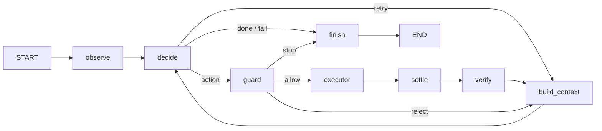

# Friday agent harness skeleton

## Purpose

This package defines only the future agent loop topology. Every default node is a no-I/O stub: it logs its name and returns `{}`. The skeleton does not import or call an LLM, executor, desktop client, screenshot facility, filesystem, or network service.



## State

`AgentState` uses plain overwrite semantics with no reducers. Screenshots are paths, never image bytes, so future checkpointing serializes only state data.

| Field | Read by | Written by |
| --- | --- | --- |
| `goal` | decide, build_context, finish | caller |
| `status` | finish | caller, finish |
| `step`, `max_steps`, `started_at` | guard, finish | caller, guard |
| `screenshot_path`, `prev_screenshot_path` | decide, settle, verify | observe, settle |
| `decision`, `pending_action`, `retries` | route_after_decide, guard | decide |
| `guard_verdict` | route_after_guard | guard |
| `last_result` | settle, verify, build_context, finish | executor |
| `history`, `hint`, `stuck_count` | decide, guard, build_context, finish | decide, guard, verify, build_context |
| `final_report` | caller | finish |

`initial_state(goal, max_steps)` supplies neutral values. The default LangGraph recursion limit is in `harness.config`.

## Nodes

| Node | Reads | Future writes | Next |
| --- | --- | --- | --- |
| observe | goal | screenshot_path | decide |
| decide | goal, screenshot paths, history, hint, retries | decision, pending_action, retries | route_after_decide |
| guard | pending_action, budgets, history, stuck_count | guard_verdict, hint, stuck_count | route_after_guard |
| executor | pending_action | last_result | settle |
| settle | screenshot_path, last_result | prev_screenshot_path, screenshot_path | verify |
| verify | screenshot paths, last_result | hint, stuck_count | build_context |
| build_context | goal, history, last_result, hint | history | decide |
| finish | all terminal context | status, final_report | END |

Expected execution failures belong in `last_result` with `ok: false`; they do not raise. Only routing reads `decision` or `guard_verdict`: `None` logs a warning and goes to finish, while an unknown value raises `ValueError`.

## Routing tables

| From | Value | Destination |
| --- | --- | --- |
| decide | action | guard |
| decide | done, fail | finish |
| decide | retry | build_context |
| guard | allow | executor |
| guard | reject | build_context |
| guard | stop | finish |

## Replacing a stub

Implement one node file later, retaining the `AgentState -> dict` shape. Or inject one replacement without editing the graph:

```python
from dataclasses import replace

from friday.harness.graph import build_graph
from friday.harness.nodes import default_nodes

graph = build_graph(replace(default_nodes(), decide=my_decide))
```

## Not in this skeleton

- LLM calls
- Executor wiring
- Approval or interrupt node
- Persistence
- Tracing
- Plan node

`docs/harness.mmd` is generated by `python scripts/draw_harness.py`. Do not edit it manually.
