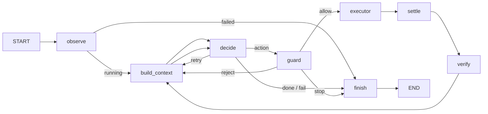

# Friday agent harness skeleton

## Purpose

This package defines the agent loop topology. `observe`, `build_context`,
`decide` (via injected, LLM-calling factories) and `guard` are implemented; the
remaining default nodes (executor, settle, verify, finish) are no-I/O stubs. The
harness itself imports no desktop client or network service at module load; I/O
is injected. Run a task through `decide` with `python -m friday run "<goal>"`
against a live sandbox (see `src/friday/__main__.py`).



## State

`AgentState` uses plain overwrite semantics with no reducers. Screenshots are paths, never image bytes, so future checkpointing serializes only state data.

The per-node read/write contract is generated from a single source
(`friday.harness.contract`, `scripts/gen_harness_contract.py`); the boundary
contract tests check every implemented node against it, so tests, code, and
docs cannot disagree:

```
<!-- GEN:node-contract -->
| Node | Reads | Writes |
| --- | --- | --- |
| observe | — | final_report, focused_app, screen_size, screenshot_path, status, windows |
| build_context | focused_app, goal, guard_verdict, hint, history, last_result, max_steps, pending_action, retries, screen_size, screenshot_path, step, windows | hint, prompt |
| decide | prompt, screenshot_path | decision, hint, pending_action, retries |
| guard | focused_app, history, max_steps, pending_action, retries, screen_size, status, step | guard_verdict, hint |
<!-- GEN:node-contract -->
```

`initial_state(goal, max_steps)` supplies neutral values. The default LangGraph recursion limit is in `harness.config`.

## Injected policy (`ControlPolicy`)

Approval and user-control status for a step are not state fields; they are carried by an injected `ControlPolicy` shared between the `build_context` and `guard` nodes. `build_context` surfaces them in the capability manifest (no input when the user controls the desktop, observing only without approval), and `guard` independently blocks input or requires approval on the same signal, so manual control gates execution even if the model was offered more than it may do. The default policy assumes no approval and no user control — conservative by design.

## Capability selection and risk tiers

`build_context` chooses capabilities independent of the goal text, based only on the authoritative registries, the configured allowlist (`harness.config`), the current `focused_app`, and the injected policy:

- Core observation and low-risk operations, and all input actions, are offered whenever the policy does not forbid them (under user control only observe capabilities are offered, no input).
- Shortcuts offered are exactly those `resolve_shortcut(name, focused_app)` accepts (`focused_app` `None` means `"other"`; an explicit-null binding never resolves), minus any `risky` shortcut when approval is not granted.
- Higher-risk operations (e.g. `delete_file`, `write_file`, `close_window`, `close_app`) are offered only when approval is granted. Under the default policy they are withheld but still named in the prompt's unavailable-note, so the model knows the class exists but needs approval that is unavailable. The whole action class is never hidden.
- Risk is a single shared source: `requires_approval(name)` in `capabilities.py` is used by both selection (to withhold) and the guard (to reject).

**Consistency invariant:** anything `build_context` offers under a policy must be something the guard could allow under the same policy (offering an operation the guard always rejects is a bug). The reverse is not required: the guard stays the enforcement point, and the model may still propose something not offered — the guard rejects it as before.

## Nodes

| Node | Reads | Future writes | Next |
| --- | --- | --- | --- |
| observe | nothing | screenshot_path, screen_size, windows, focused_app; on fatal capture failure status, final_report | route_after_observe |
| decide | prompt, screenshot_path | decision, pending_action, retries, hint | route_after_decide |
| guard | pending_action, screen_size, budgets, history, stuck_count, focused_app, status | guard_verdict, hint, stuck_count | route_after_guard |
| executor | pending_action | last_result | settle |
| settle | screenshot_path, last_result | prev_screenshot_path, screenshot_path, screen_size, windows, focused_app | verify |
| verify | screenshot paths, last_result | hint, stuck_count | build_context |
| build_context | goal, screen_size, windows, focused_app, history, last_result, hint, step, max_steps, retries, status, pending_action, guard_verdict | prompt, hint | decide |
| finish | all terminal context | status, final_report | END |

Expected execution failures belong in `last_result` with `ok: false`; they do not raise. Only routing reads `decision` or `guard_verdict`: `None` logs a warning and goes to finish, while an unknown value raises `ValueError`.

## Prompt flow

`build_context` renders the complete prompt — the static agent rules together with the dynamic facts — into `state["prompt"]`, and is the only node allowed to write that field. The static rules are a constant in `render.py`, never stored in mutable state themselves; they are folded into the returned `prompt` string, not injected into `decide` as a separate dependency. Other nodes write facts such as `hint` and `last_result`, never prompt text. `screen_size` is internal coordinate/bounds data and must never be rendered into a prompt. `build_context` folds a hint into the prompt and clears it afterward.

`observe` is the only implemented node: an injected desktop client collects the initial screenshot and safe system data, then an injected trace writer stores the screenshot and safe observation metadata. It does not build a prompt. Shortcut execution later resolves bindings against a fresh active-window lookup; a future guard may call the same resolver to reject unavailable shortcuts, and a future context builder may render only shortcuts available for `focused_app`.

## Routing tables

| From | Value | Destination |
| --- | --- | --- |
| observe | `status == failed` | finish |
| observe | any other status | build_context |
| decide | action | guard |
| decide | done, fail | finish |
| decide | retry | build_context |
| guard | allow | executor |
| guard | reject | build_context |
| guard | stop | finish |

## Replacing a stub

Implement one node file later, retaining the `AgentState -> dict` shape. Or inject one replacement without editing the graph:

```python
from dataclasses import replace

from friday.harness.graph import build_graph
from friday.harness.nodes import default_nodes

graph = build_graph(replace(default_nodes(), decide=my_decide))
```

## Not in this skeleton

- LLM calls
- Executor wiring
- Approval or interrupt node
- Persistence
- Tracing
- Plan node

`docs/harness.mmd` is generated by `python scripts/draw_harness.py`. Do not edit it manually.
