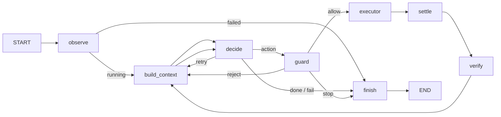

# Friday agent harness skeleton

## Purpose

This package defines only the future agent loop topology. Every default node is a no-I/O stub: it logs its name and returns `{}`. The skeleton does not import or call an LLM, executor, desktop client, screenshot facility, filesystem, or network service.



## State

`AgentState` uses plain overwrite semantics with no reducers. Screenshots are paths, never image bytes, so future checkpointing serializes only state data.

| Field | Read by | Written by |
| --- | --- | --- |
| `goal` | build_context, finish | caller |
| `status` | finish | caller, finish |
| `step`, `max_steps`, `started_at` | guard, finish | caller, guard |
| `screenshot_path`, `prev_screenshot_path` | decide, settle, verify | observe, settle |
| `prompt` | decide | build_context only |
| `screen_size` | guard, settle | observe, settle |
| `windows`, `focused_app` | build_context, guard, settle | observe, settle |
| `decision`, `pending_action`, `retries` | route_after_decide, guard | decide |
| `guard_verdict` | route_after_guard | guard |
| `last_result` | settle, verify, build_context, finish | executor |
| `history`, `hint`, `stuck_count` | guard, build_context, finish | decide, guard, verify, build_context |
| `final_report` | caller | finish |

`initial_state(goal, max_steps)` supplies neutral values. The default LangGraph recursion limit is in `harness.config`.

## Nodes

| Node | Reads | Future writes | Next |
| --- | --- | --- | --- |
| observe | nothing | screenshot_path, screen_size, windows, focused_app; on fatal capture failure status, final_report | route_after_observe |
| decide | prompt, screenshot_path, static system prompt dependency | decision, pending_action, retries, hint | route_after_decide |
| guard | pending_action, screen_size, budgets, history, stuck_count | guard_verdict, hint, stuck_count | route_after_guard |
| executor | pending_action | last_result | settle |
| settle | screenshot_path, last_result | prev_screenshot_path, screenshot_path, screen_size, windows, focused_app | verify |
| verify | screenshot paths, last_result | hint, stuck_count | build_context |
| build_context | goal, screen_size, windows, history, last_result, hint, step, max_steps | prompt, hint | decide |
| finish | all terminal context | status, final_report | END |

Expected execution failures belong in `last_result` with `ok: false`; they do not raise. Only routing reads `decision` or `guard_verdict`: `None` logs a warning and goes to finish, while an unknown value raises `ValueError`.

## Prompt flow

The static system prompt is identical for each call and will be injected into `decide` as a dependency when model wiring is added; it is not state. `build_context` creates the complete dynamic prompt in `state["prompt"]` from current facts and is the only node allowed to write that field. Other nodes write facts such as `hint` and `last_result`, never prompt text. `screen_size` is internal coordinate/bounds data and must never be rendered into a prompt. `build_context` folds a hint into the prompt and clears it afterward.

`observe` is the only implemented node: an injected desktop client collects the initial screenshot and safe system data, then an injected trace writer stores the screenshot and safe observation metadata. It does not build a prompt. Shortcut execution later resolves bindings against a fresh active-window lookup; a future guard may call the same resolver to reject unavailable shortcuts, and a future context builder may render only shortcuts available for `focused_app`.

## Routing tables

| From | Value | Destination |
| --- | --- | --- |
| observe | `status == failed` | finish |
| observe | any other status | build_context |
| decide | action | guard |
| decide | done, fail | finish |
| decide | retry | build_context |
| guard | allow | executor |
| guard | reject | build_context |
| guard | stop | finish |

## Replacing a stub

Implement one node file later, retaining the `AgentState -> dict` shape. Or inject one replacement without editing the graph:

```python
from dataclasses import replace

from friday.harness.graph import build_graph
from friday.harness.nodes import default_nodes

graph = build_graph(replace(default_nodes(), decide=my_decide))
```

## Not in this skeleton

- LLM calls
- Executor wiring
- Approval or interrupt node
- Persistence
- Tracing
- Plan node

`docs/harness.mmd` is generated by `python scripts/draw_harness.py`. Do not edit it manually.
